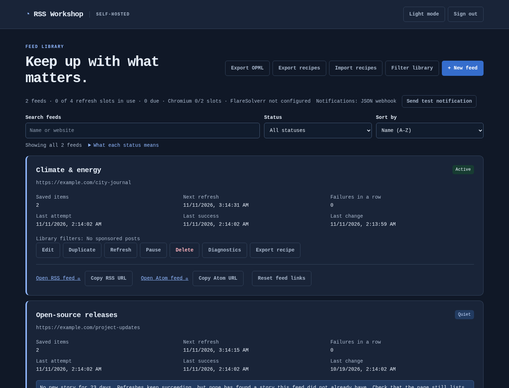
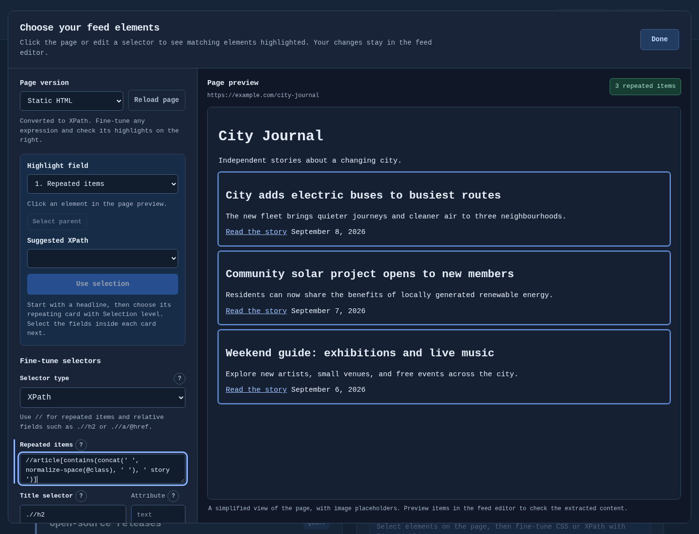
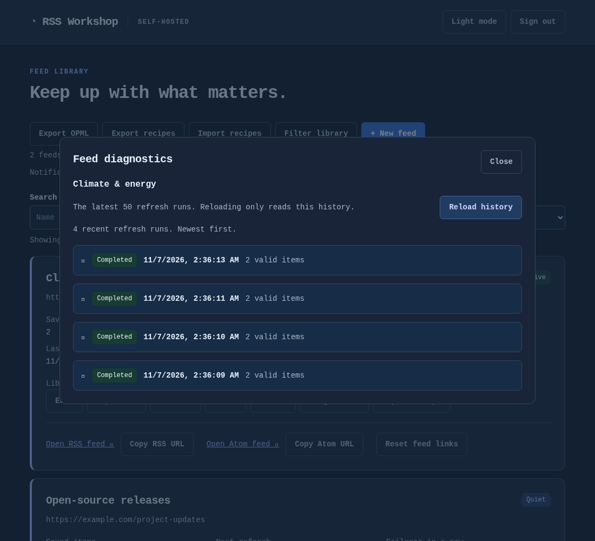

<!--
  The landing page, written for the site alone. Links are relative to this
  file in the repository, as in every guide; scripts/docs-site.py points them
  at the published pages. The README stays the front page on GitHub, and
  get-started.md beside this file publishes its sections, so keep facts there
  and this page short.
-->

# RSS Workshop

Self-hosted RSS and Atom feeds for websites that don’t provide them.
{ .rw-lead }

Build a feed by clicking on the page or with CSS and XPath selectors, render
JavaScript sites with Chromium, filter the stories, and subscribe with any
reader. It runs on your own machine, with no account and no third-party
service.

[Get started](get-started.md){ .md-button .md-button--primary }
[Try it on the demo site](../../docs/examples/README.md){ .md-button }

{ .rw-shot }

## What it does { #what-it-does }

-   :lucide-mouse-pointer-click:{ .lg .middle } **Click to choose, then fine-tune**

    ---

    Click a repeating card, then its title, link, image and date. CSS and
    XPath sit side by side with live match highlighting.

    [:lucide-arrow-right: Visual selection](../../docs/visual-selector.md)

-   :lucide-app-window:{ .lg .middle } **JavaScript pages**

    ---

    Sandboxed Chromium renders pages that need a browser, and an optional
    external FlareSolverr handles challenge pages.

    [:lucide-arrow-right: Chromium rendering](../../docs/browser.md)

-   :lucide-file-text:{ .lg .middle } **The article, not the teaser**

    ---

    Follow each story’s link and publish the full article, with cleanup rules
    for share bars and other clutter.

    [:lucide-arrow-right: Full article content](../../docs/atom.md#full-article-content)

-   :lucide-rss:{ .lg .middle } **Feeds as sources too**

    ---

    Read an existing RSS or Atom feed to filter it, or to publish its full
    articles behind one private link.

    [:lucide-arrow-right: Feed sources](../../docs/feed-sources.md)

-   :lucide-list-filter:{ .lg .middle } **Keep what you want**

    ---

    Include and exclude rules with nested groups and bulk keyword lists, and a
    filter library to reuse rules across feeds.

    [:lucide-arrow-right: Story filters](../../docs/filtering.md)

-   :lucide-copy-check:{ .lg .middle } **Feeds that stay put**

    ---

    RSS and Atom with stable item identities and dates, served from saved
    stories, plus an OPML export of every feed.

    [:lucide-arrow-right: RSS and Atom output](../../docs/atom.md)

-   :lucide-activity:{ .lg .middle } **Know when a feed breaks**

    ---

    The library points out feeds gone quiet, with per-feed diagnostics,
    Prometheus metrics and optional notifications.

    [:lucide-arrow-right: Monitoring](../../docs/operations.md#the-library-dashboard)

-   :lucide-package:{ .lg .middle } **Recipes that travel**

    ---

    Export a feed’s setup as a JSON recipe, import it elsewhere, or duplicate
    a feed to try other selectors without touching it.

    [:lucide-arrow-right: Recipe export and import](../../docs/recipe-portability.md)

-   :lucide-server:{ .lg .middle } **Yours to run**

    ---

    MIT licensed. Docker Compose or a single Linux executable, SQLite or
    PostgreSQL, behind your own proxy or VPN.

    [:lucide-arrow-right: Deployment](../../docs/deployment.md)

## Your first feed { #your-first-feed }

1. **Install it.** A few commands start the Docker image, which includes
   Chromium and SQLite; a standalone Linux executable works too.
2. **Build a feed.** Choose **New feed**, enter a page, choose its elements
   visually, and preview exactly what a reader will receive.
3. **Subscribe.** Copy the RSS or Atom link into your reader. Readers are
   served saved stories, so a slow or broken site never stalls them.

[Install and build a first feed](get-started.md){ .md-button .md-button--primary }

No site in mind yet? These pages publish a small
[demo newspaper](../../docs/examples/demo-site/index.html) to practise on,
with ready-made recipes for it: see
[example recipes and demo site](../../docs/examples/README.md).

## A closer look { #a-closer-look }

<figure markdown>
{ .rw-shot }
<figcaption>Choose elements on the page and refine CSS or XPath beside it.</figcaption>
</figure>

<figure markdown>
{ .rw-shot }
<figcaption>Diagnostics keep each feed’s last 50 refreshes, with match counts and field samples.</figcaption>
</figure>

Screenshots use sample feeds.

## Find your way { #find-your-way }

-   **Build feeds**

    ---

    [Visual selection](../../docs/visual-selector.md) ·
    [feed sources](../../docs/feed-sources.md) ·
    [story filters](../../docs/filtering.md) ·
    [publication dates](../../docs/dates.md) ·
    [output, full articles and cleanup](../../docs/atom.md) ·
    [recipe export and import](../../docs/recipe-portability.md)

-   **Fetching**

    ---

    [Chromium rendering](../../docs/browser.md) and its sandbox ·
    [FlareSolverr](../../docs/flaresolverr.md) for challenge pages

-   **Run it**

    ---

    [Deployment and configuration](../../docs/deployment.md) ·
    [reverse proxy](../../docs/reverse-proxy.md) ·
    [monitoring, backups and upgrades](../../docs/operations.md) ·
    [PostgreSQL](../../docs/postgresql.md) ·
    [Gluetun VPN](../../docs/gluetun.md)

-   **Project**

    ---

    [Changelog](../../CHANGELOG.md) ·
    [security](../../SECURITY.md) ·
    [contributing](../../CONTRIBUTING.md) ·
    [builds and releases](../../docs/releases.md) ·
    [licensing](../../docs/licensing.md) ·
    [dependency notices](../../docs/dependencies.md)

